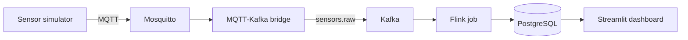

# Real-Time Environmental Monitoring and Fault Detection

A streaming pipeline that spots overheating, dying batteries and dead sensors within seconds.
Sensors publish readings over **MQTT**, **Kafka** buffers them, **Flink** detects faults in
real time, and a **Streamlit** dashboard shows the results.

Data: [Intel Berkeley Research Lab sensor dataset](http://db.csail.mit.edu/labdata/labdata.html)
(54 sensors, about 2.3 million readings).

## Architecture



## What it detects

| Alert | Rule |
|---|---|
| High temperature | Reading above the temperature limit |
| Sudden jump | Large temperature rise within one minute |
| Low battery | Voltage below the battery limit |
| Silent sensor | No data for 2 minutes (event time and watermarks) |

## Status

| Step | State |
|---|---|
| Mosquitto + Kafka (Docker Compose) | written, not yet tested |
| Dataset replay simulator | written, not yet tested |
| Output schema (`db/schema.sql`) | done |
| Dashboard with sample data | working |
| MQTT to Kafka bridge | next |
| Flink job writing to Postgres | planned |

## Try the dashboard (no pipeline needed)

```bash
cd dashboard
python3 -m venv .venv
source .venv/bin/activate
pip install -r requirements.txt
python sample_data.py
streamlit run app.py
```

Drag the **pipeline clock** to replay a 2-hour run, or turn on **Auto-play** in the sidebar.

To show real Flink output instead, set `DATABASE_URL` (environment variable or Streamlit
secret) to a Postgres database created with `db/schema.sql`.

## Run the ingestion side

1. Download `data.txt.gz` from the dataset page, then:

   ```bash
   mkdir -p data
   gunzip -c ~/Downloads/data.txt.gz > data/data.txt
   ```

2. Start the brokers and replay the data:

   ```bash
   docker compose up -d
   pip install -r simulator/requirements.txt
   python simulator/replay.py --speed 500 --anomalies
   ```

3. Watch the messages arrive:

   ```bash
   docker exec -it mosquitto mosquitto_sub -t 'sensors/#' -v
   ```

## Project structure

```
iot-streaming-pipeline/
├── docker-compose.yml     Mosquitto and Kafka
├── simulator/             replays the dataset to MQTT
├── db/schema.sql          tables the Flink job writes
├── dashboard/             Streamlit app and sample data
└── mosquitto/             broker config
```

## Deploy the dashboard (free)

Push the repo to GitHub, then on Streamlit Community Cloud create an app with main file
`dashboard/app.py`. Add `DATABASE_URL` under Secrets if you use a hosted Postgres.

## Acknowledgments

Sensor data collected by Peter Bodik, Wei Hong, Carlos Guestrin, Sam Madden, Mark Paskin and
Romain Thibaux at the Intel Berkeley Research Lab.


